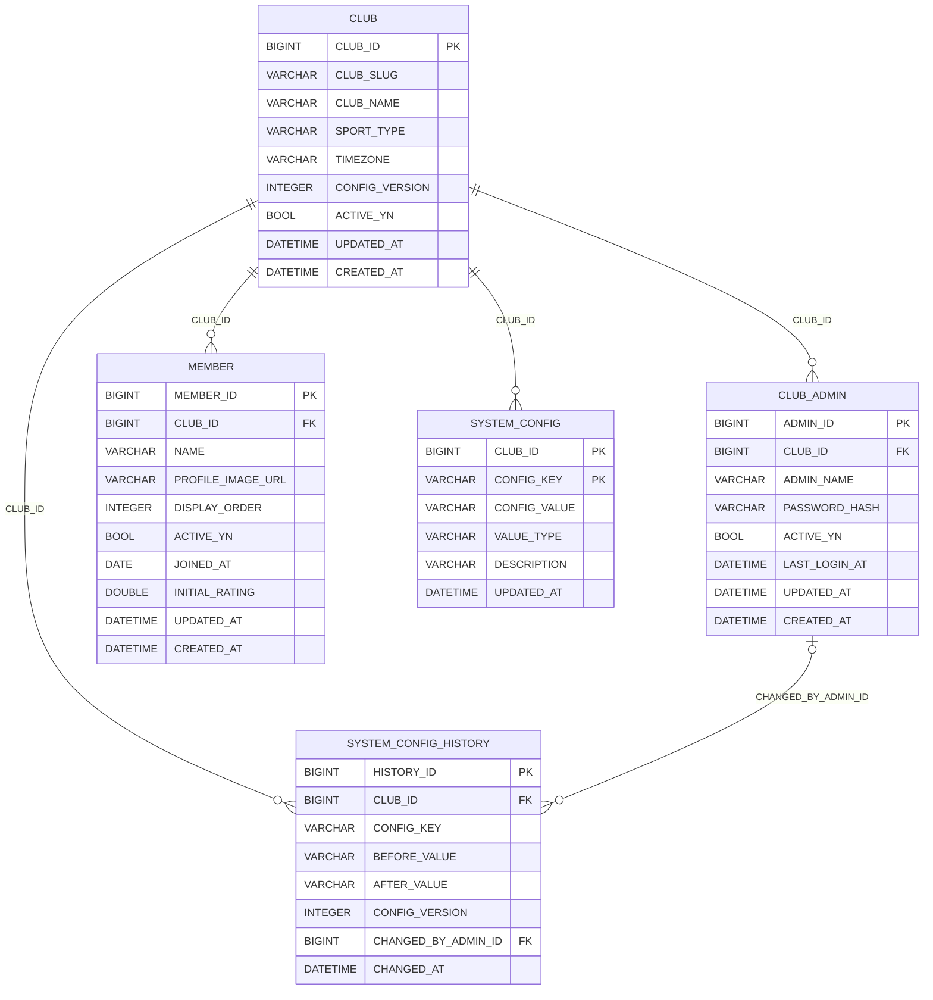
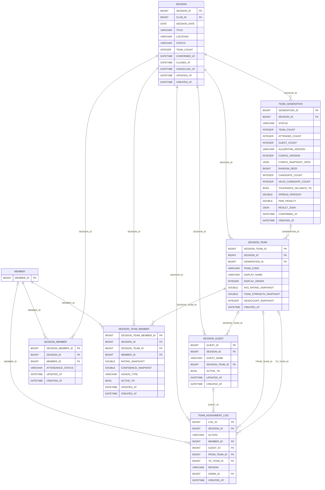
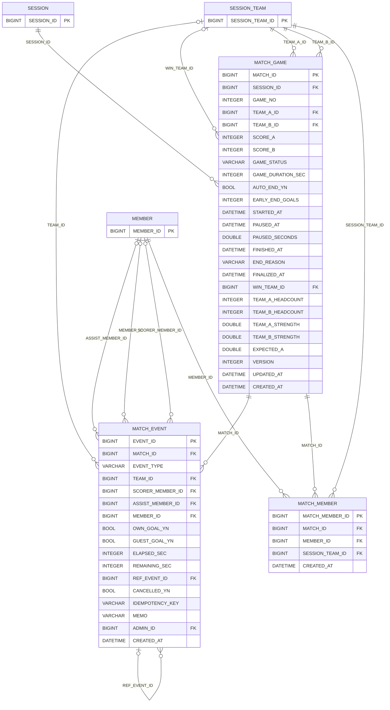
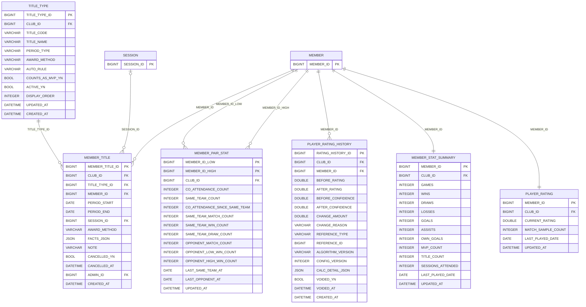
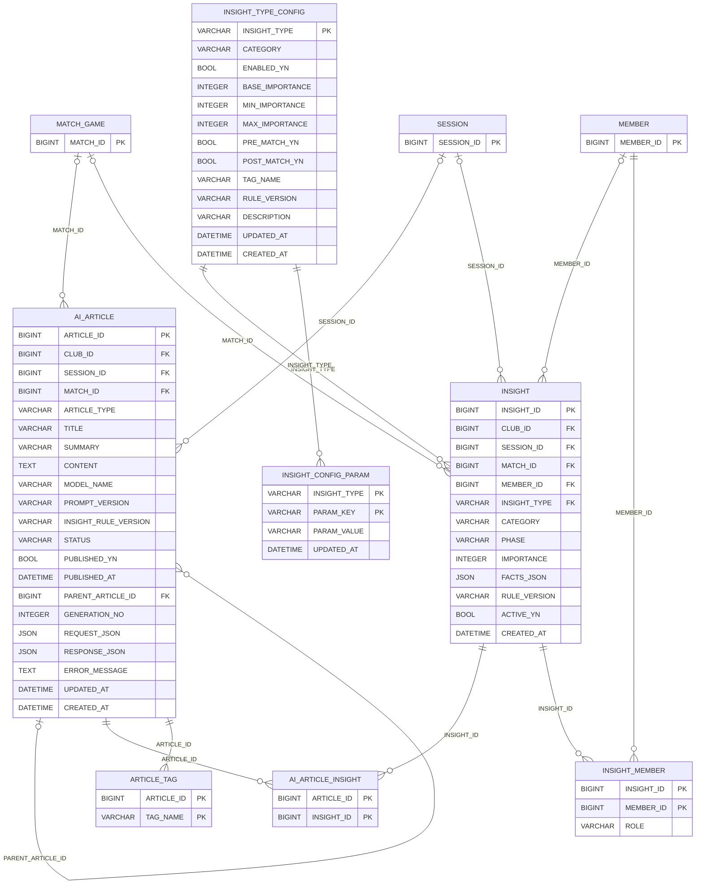

# Clubwire ERD

> 자동 생성: `python scripts/gen_docs.py`. 영역별로 나눠 그렸고, 다른 영역 테이블은 키만 표시.

## 1. Club / Member / Config

## 2. Session / Team

## 3. Match

## 4. Rating / Stats / Pair / Title

## 5. The Wire

